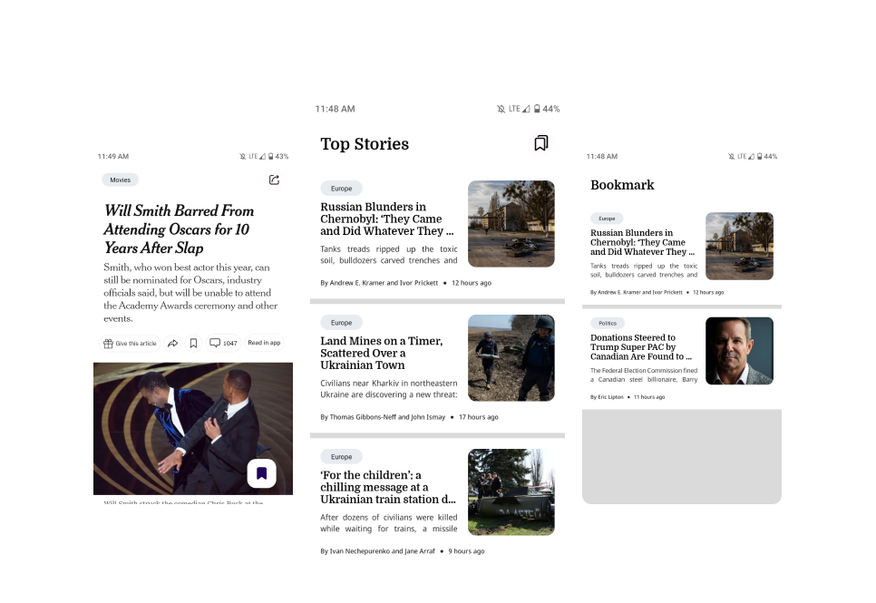
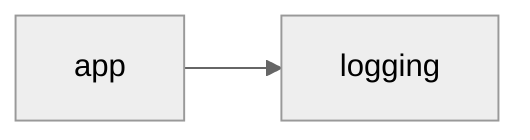

<h1 align="center">NY Times</h1>

<p align="center">  
This project is an Android application that demonstrates the effective implementation of Clean Architecture in Android app development. It utilizes The New York Times API to fetch and display the latest news to users.
</p>

<p align="center">
  <a href="https://opensource.org/licenses/MIT"></a>
  <a href="https://developer.android.com/about/versions/nougat"></a>
  
</p>

<p align="center">

</p>

## Tech Stack & Architecture

- **Minimum SDK Level**: 24 (Android 7.0+)
- **Compile / Target SDK**: 37
- **Language & Runtime**: [Kotlin](https://kotlinlang.org/) with [Coroutines](https://github.com/Kotlin/kotlinx.coroutines) & Flow
- **Build System & Tooling**:
  - Gradle with Java 17 toolchain
  - **Gradle Version Catalog** (`gradle/libs.versions.toml`) for centralized dependency management
  - **Build Logic** (`build-logic`) convention plugins (`nytimes.android.application`, `nytimes.android.library`)
  - [Spotless](https://github.com/diffplug/spotless) with ktlint for automated code formatting
- **UI & Presentation**:
  - [Jetpack Compose](https://developer.android.com/jetpack/compose) & ViewBinding
  - [Material Components](https://github.com/material-components/material-components-android)
  - [Glide](https://github.com/bumptech/glide) & [Coil](https://coil-kt.github.io/coil/) for image loading and caching
  - [Lottie](https://github.com/airbnb/lottie-android) for native animations
  - [SwipeRefreshLayout](https://developer.android.com/jetpack/androidx/releases/swiperefreshlayout)
- **Architecture**:
  - Clean Architecture (Domain, Data, Presentation layers)
  - MVVM Architecture with StateFlow / LiveData
  - Repository Pattern
- **Jetpack Libraries**:
  - [Navigation Component](https://developer.android.com/guide/navigation) with Safe Args
  - [Room Persistence](https://developer.android.com/training/data-storage/room) for local caching
  - [Lifecycle & ViewModel](https://developer.android.com/topic/libraries/architecture)
- **Dependency Injection**:
  - [Dagger Hilt](https://dagger.dev/hilt/) for dependency injection
- **Networking & API**:
  - [Retrofit](https://square.github.io/retrofit/) & [OkHttp](https://square.github.io/okhttp/)
  - [Gson](https://github.com/google/gson) for JSON serialization
  - Custom logging interceptor with [Timber](https://github.com/JakeWharton/timber)
- **Monitoring & Analytics**:
  - [Firebase Crashlytics](https://firebase.google.com/products/crashlytics) & [Firebase Analytics](https://firebase.google.com/products/analytics) (via Firebase BoM)

## Project Structure

```
nytimes-android/
├── app/                  # Main application module (UI, DI, domain, data)
├── logging/              # Reusable logger module with Timber wrapper
├── build-logic/          # Gradle composite build with convention plugins
│   └── convention/       # Convention plugins for Android application and library modules
└── gradle/
    └── libs.versions.toml # Gradle Version Catalog
```

## Module Dependency Graph



## API

Uses the [New York Times Top Stories API](https://developer.nytimes.com/get-started/):
```
https://api.nytimes.com/svc/topstories/v2/home.json?api-key=yourkey
```

## Demo App
[](https://www.youtube.com/watch?v=GoeznEif9ps "Now in Android: 55")

# License

```xml
MIT License

Copyright (c) [2022] [Ar Razy Fathan Rabbani]

Permission is hereby granted, free of charge, to any person obtaining a copy
of this software and associated documentation files (the "Software"), to deal
in the Software without restriction, including without limitation the rights
to use, copy, modify, merge, publish, distribute, sublicense, and/or sell
copies of the Software, and to permit persons to whom the Software is
furnished to do so, subject to the following conditions:

The above copyright notice and this permission notice shall be included in
all copies or substantial portions of the Software.

THE SOFTWARE IS PROVIDED "AS IS", WITHOUT WARRANTY OF ANY KIND, EXPRESS OR
IMPLIED, INCLUDING BUT NOT LIMITED TO THE WARRANTIES OF MERCHANTABILITY,
FITNESS FOR A PARTICULAR PURPOSE AND NONINFRINGEMENT. IN NO EVENT SHALL THE
AUTHORS OR COPYRIGHT HOLDERS BE LIABLE FOR ANY CLAIM, DAMAGES OR OTHER
LIABILITY, WHETHER IN AN ACTION OF CONTRACT, TORT OR OTHERWISE, ARISING FROM,
OUT OF OR IN CONNECTION WITH THE SOFTWARE OR THE USE OR OTHER DEALINGS IN
THE SOFTWARE.
```
